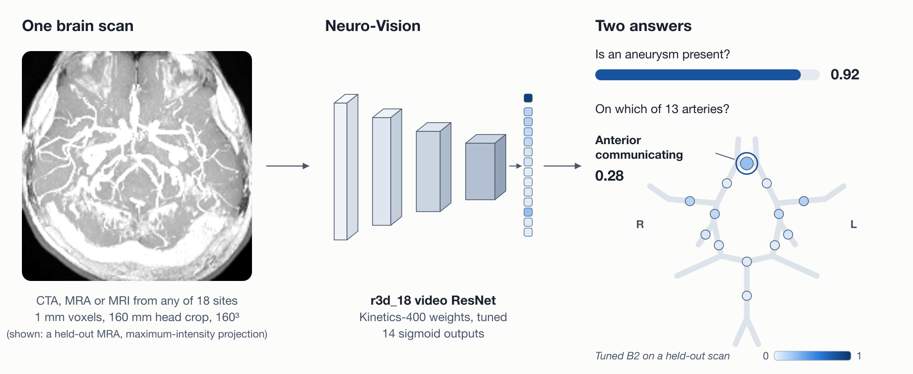
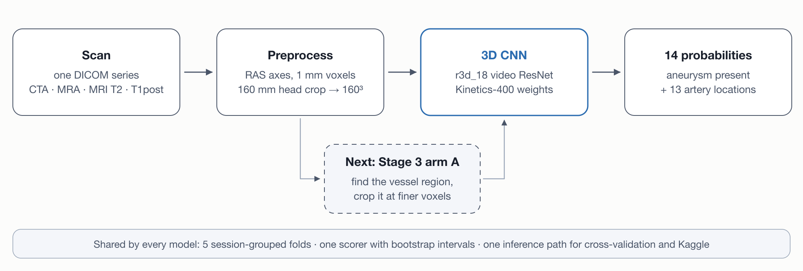

<div align="center">

# Neuro-Vision

**Detection and localization of intracranial aneurysms in 3D brain scans**

[](https://www.python.org/)
[](https://pytorch.org/)
[](https://monai.io/)
[](https://forge.coreweave.com/wandb/muhammadobaidullah98-northeastern-university/neuro-vision/reports/Neuro-Vision-midterm-checkpoint--VmlldzoxODIzOTI4Nw)
[](https://docs.astral.sh/ruff/)
[](LICENSE)

[How it works](#how-it-works) · [Results](#results) · [Reports](#reports) · [Quick start](#quick-start) · [Roadmap](#roadmap)

</div>

Neuro-Vision is a 3D convolutional network that reads one brain scan and answers two questions:
**is an intracranial aneurysm present**, and **on which of 13 arteries does it sit?** It is trained
and evaluated on the RSNA Intracranial Aneurysm Detection dataset: four scan types from 18 sites.

> [!IMPORTANT]
> Neuro-Vision is a research model. It is not a medical device and must not be used for diagnosis.

<p align="center">
  
</p>

<sub>One held-out MRA scan in, the tuned model's 14 probabilities out. The dots mark the 13 artery
locations on the circle of Willis; darker means more likely. The expert labelled three arteries,
including the anterior communicating artery, the model's top location.</sub>

## At a glance

| | |
|:--|:--|
| **Input** | One CTA, MRA or MRI series (DICOM) |
| **Output** | 14 probabilities: Aneurysm Present, plus one per artery location |
| **Model** | r3d_18 video ResNet with Kinetics-400 weights, 33 M parameters |
| **Data** | 4,348 training series from 18 sites ([dataset reference](docs/dataset.md)) |
| **Validation** | 5-fold cross-validation, grouped by scan session |
| **Metric** | ½ × (AUC of Aneurysm Present + mean AUC of the 13 locations) |
| **5-fold score** | **0.688** out of fold (metadata-only baseline: 0.640) |
| **Status** | Stages 1–2 complete: tuned baseline. Stage 3, arm A, in progress. |

## How it works

<p align="center">
  
</p>

1. **Scan.** One DICOM series of any of four types: CTA, MRA, MRI T2 or MRI T1 post-contrast.
2. **Preprocess.** A geometry check, RAS axes, 1 mm voxels, then a 160 mm box on the head at 160³.
   4,311 of 4,348 series pass; the other 37 receive the label prior.
3. **3D CNN.** A video ResNet-18 starts from Kinetics-400 weights. Its backbone learns at 0.1× the
   head's rate. A left–right flip swaps the left and right labels with it.
4. **14 probabilities.** One sigmoid per label. One function, `infer/predict.py`, turns DICOM into
   these 14 numbers for both cross-validation and Kaggle.

Stage 3 inserts one step: arm A finds the vessel region and gives the same network a finer crop of
it.

## Results

Out-of-fold scores on all 4,348 training series; the same five folds for every model.

| Model | Input | 5-fold score | Aneurysm Present AUC | Mean location AUC |
|:--|:--|--:|--:|--:|
| B0 · label prior | none | 0.500 | 0.500 | 0.500 |
| B1 · gradient boosting | age, sex, scan type | 0.640 | 0.672 | 0.609 |
| **B2 · r3d_18, tuned** | 1 mm head crop, 160³ | **0.688** | **0.717** | **0.660** |
| Arm A · vessel-region crop | finer crop | Stage 3 | | |

<sub>Sources: [`results/b0.json`](results/b0.json), [`results/b1.json`](results/b1.json),
[`results/b2.json`](results/b2.json). B1 shows what metadata alone earns; an image model must beat
it.</sub>

<p align="center">
  
</p>

<sub>From the proposed baseline to the tuned one. Each step changed one setting and was kept only
if it helped on fold 0. The five-fold run confirms the result on all series.</sub>

<p align="center">
  
</p>

<p align="center">
  
</p>

<sub>Where the tuned baseline looks. Across 1,835 held-out positives, the Grad-CAM peak lies within
20 mm of the aneurysm in 1.7% of scans, the same rate as a random point in the head. This is the
case for Stage 3: give the network the vessel region, not the whole head.</sub>

## Reports

- **[Midterm checkpoint](docs/check-point.md):** Stage 1 baseline, five Stage 2 experiments,
  diagnostics and the Stage 3 plan.
- **[W&B report](https://forge.coreweave.com/wandb/muhammadobaidullah98-northeastern-university/neuro-vision/reports/Neuro-Vision-midterm-checkpoint--VmlldzoxODIzOTI4Nw):**
  the same report with live training curves for every run.
- **[Dataset reference](docs/dataset.md):** scan types, label counts, preprocessing and splits.

## Quick start

**Requirements:** Python 3.12, [uv](https://docs.astral.sh/uv/), and a CUDA GPU for training (the
tuned config peaks at 7.5 GB). Inference runs on a CPU.

```bash
git clone https://github.com/as-obaid/neuro-vision.git
cd neuro-vision
uv sync
cp .env.example .env    # set NV_STORE (data folder) and the W&B keys
```

Reproduce the tuned baseline. Each step reads and writes under `$NV_STORE`; the pretrained weights
listed in [`data/manifests/weights.yaml`](data/manifests/weights.yaml) go in `$NV_STORE/weights/`.

```bash
bash scripts/download.sh                                   # Kaggle data, ~311 GB unzipped
uv run python scripts/audit.py --verify                    # every series present
uv run python scripts/derive_labels.py                     # corrected labels
uv run python scripts/scan_headers.py                      # DICOM headers for grouping
uv run python scripts/make_folds.py --group-key FrameOfReferenceUID
uv run python scripts/preprocess.py --resample mm --size 160   # 1 mm head crop at 160³
uv run python scripts/train.py configs/base/b1.yaml        # metadata baseline, all folds
for k in 0 1 2 3 4; do uv run python scripts/train.py configs/final/b2_final.yaml --fold $k; done
uv run python scripts/score_oof.py configs/final/b2_final.yaml
uv run python scripts/diagnose.py configs/final/b2_final.yaml --against configs/base/b1.yaml
```

On a Slurm cluster, `slurm/submit.sh` runs the same scripts as batch jobs.

## Repository structure

```text
configs/          YAML configs: base (B0–B2), stage2 and tune (one change each), final
data/manifests/   data sources, fold seed and SHA-256 sums; never scan data
docs/             checkpoint report, dataset reference, figures
results/          scored results and diagnostics as JSON
scripts/          entry points: audit, labels, folds, preprocess, train, score, diagnose
slurm/            batch jobs and cluster helpers
src/neurovision/
  baselines/      label prior (B0) and gradient boosting (B1)
  data/           DICOM reading, preprocessing, folds, augmentation
  models/         3D ResNets and the Kinetics r3d_18
  train/          training loop, losses, EMA, schedule
  evaluate/       competition metric, bootstrap, subgroups, operating points
  infer/          DICOM to 14 probabilities
  track/          W&B logging and run metadata
tests/            pytest suite
```

## Roadmap

- [x] Data audit, corrected labels and a session-grouped 5-fold split
- [x] Competition metric, checked against Kaggle's code to 1e-6
- [x] Stage 1: baselines B0, B1 and B2 as proposed
- [x] Stage 2: five controlled experiments; tuned B2 confirmed on five folds (0.688)
- [ ] Stage 3: arm A, vessel-region crop at finer resolution
- [ ] Stage 3: arm B, vessel guidance (stretch goal)
- [ ] Kaggle late submission, run once on the final models
- [ ] Weights and model card on Hugging Face
- [ ] Final report and demo

## Citation

```bibtex
@software{obaidullah2026neurovision,
  author = {Obaidullah, Muhammad},
  title  = {Neuro-Vision: Detection and localization of intracranial aneurysms in 3D brain scans},
  year   = {2026},
  url    = {https://github.com/as-obaid/neuro-vision}
}
```

Please also cite the dataset ([Correia de Verdier et al., 2026](https://arxiv.org/abs/2610.01135)).

## License and acknowledgements

- **Code:** Apache-2.0 ([LICENSE](LICENSE)).
- **Labels:** the corrected labels derive from artery masks released under CC BY-NC 4.0 by
  [Shi et al., 2026](https://arxiv.org/abs/2606.26706). They are not stored here.
- **Data:** the scans are subject to the competition rules and are not redistributed.
- **Pretrained weights:** torchvision's Kinetics-400 and ImageNet weights, pinned by SHA-256.

Thanks to RSNA, the contributing sites and the dataset's annotators; to Shi et al. for the artery
masks; to the MONAI and PyTorch teams; and to Northeastern University Research Computing for the
Explorer cluster. Neuro-Vision began as the term project for AAI 6640 Applied Deep Learning at
Northeastern University.
