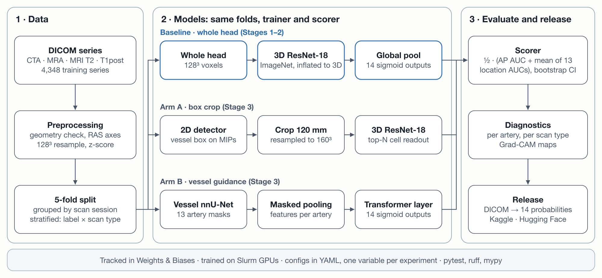
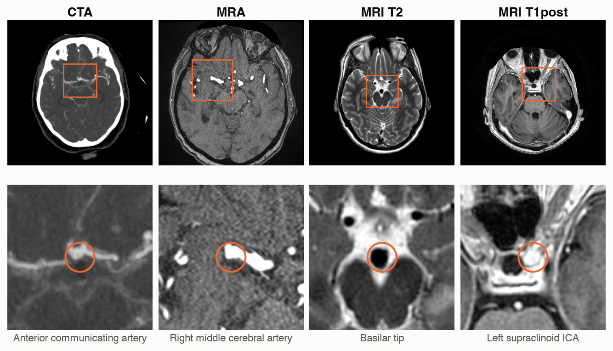
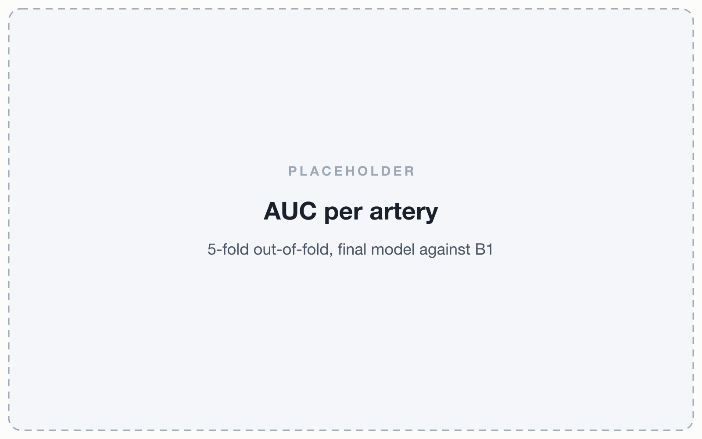
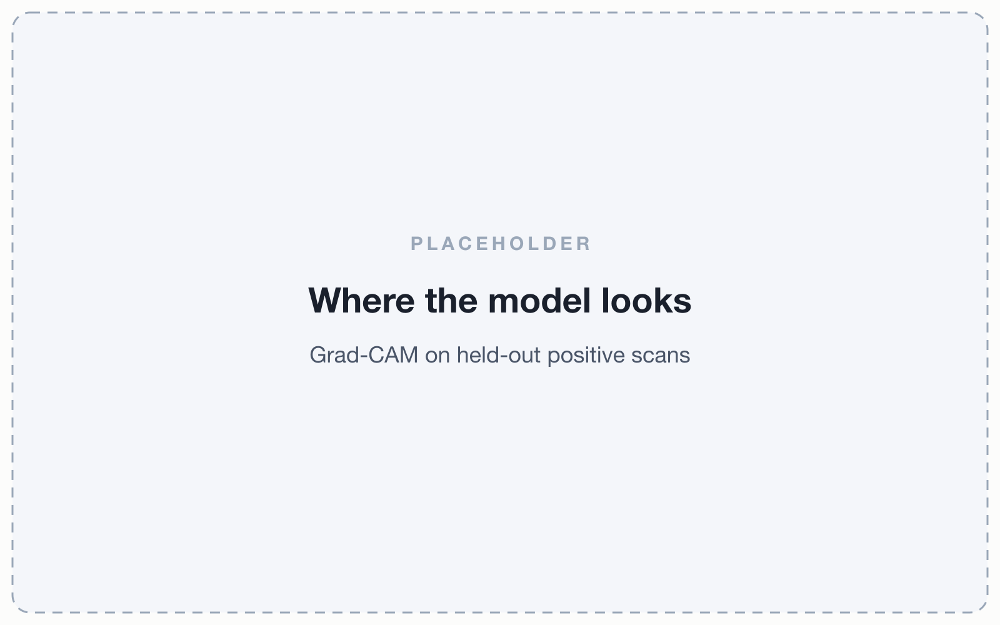

<div align="center">

# Neuro-Vision

**Detection and localization of intracranial aneurysms in 3D brain scans**

[](https://www.python.org/)
[](https://pytorch.org/)
[](https://monai.io/)
[](https://wandb.ai/muhammadobaidullah98-northeastern-university/neuro-vision)
[](#model-weights)
[](https://docs.astral.sh/ruff/)
[](LICENSE)

[How it works](#how-it-works) · [Results](#results) · [Model weights](#model-weights) · [Quick start](#quick-start) · [Citation](#citation)

</div>

Neuro-Vision is a 3D convolutional network that reads one brain scan and answers two questions:
**is an intracranial aneurysm present**, and **on which of 13 arteries does it sit?** It is trained
and evaluated on the RSNA Intracranial Aneurysm Detection dataset, which spans four scan types and
18 sites.

> [!IMPORTANT]
> Neuro-Vision is a research model. It is not a medical device and must not be used for diagnosis.

<p align="center">
  
</p>

<sub>One scan in, 14 probabilities out. The dots mark the 13 artery locations on the circle of
Willis; darker means more likely. The values are illustrative.</sub>
<!-- TODO: redraw with the final model's prediction on this held-out series -->

## At a glance

| | |
|:--|:--|
| **Input** | One CTA, MRA or MRI series (DICOM), resampled to 128³ voxels |
| **Output** | 14 probabilities: Aneurysm Present, plus one per artery location |
| **Model** | 3D ResNet-18, ImageNet weights inflated to 3D |
| **Data** | 4,348 training series from 18 sites ([dataset reference](docs/dataset.md)) |
| **Validation** | 5-fold cross-validation, grouped by scan session |
| **Metric** | ½ · (AUC of Aneurysm Present + mean AUC of the 13 locations) |
| **5-fold score** | **TBD** (metadata-only baseline: 0.640) |
| **Kaggle private score** | **TBD** |

## How it works

<p align="center">
  
</p>

1. **Preprocess.** Each series passes a geometry check, then is reoriented to RAS, resampled to
   128³ and z-scored. 4,311 of 4,348 series pass; the other 37 receive the label prior.
2. **Split.** Five folds, stratified by label × scan type. Series that share a
   FrameOfReferenceUID (one scanning session) always share a fold.
3. **Train the baseline.** A 3D ResNet-18 starts from ImageNet weights inflated to 3D. Its backbone
   learns at 0.1× the head's rate. A left–right flip swaps the left and right labels with it.
4. **Specialize (Stage 3).** Arm A reads a detected vessel box at higher resolution. Arm B pools
   features inside 13 artery masks from a vessel segmenter.
5. **Score and release.** One scorer serves every model, with paired-bootstrap confidence
   intervals. One function, `infer/predict.py`, turns DICOM into 14 probabilities for both
   cross-validation and Kaggle.

## Data

Neuro-Vision uses the [RSNA Intracranial Aneurysm Detection](https://www.kaggle.com/competitions/rsna-intracranial-aneurysm-detection)
dataset ([Correia de Verdier et al., 2026](https://arxiv.org/abs/2610.01135)). It has 4,348
training series, 1,863 of them positive (42.8%).

<p align="center">
  
</p>

<sub>One labelled aneurysm per scan type. Top: annotated slice. Bottom: 50 mm crop around the
expert's centre point.</sub>

- **Scan types:** CTA 1,808 · MRA 1,252 · MRI T2 983 · MRI T1 post-contrast 305.
- **Labels:** corrected labels derived from the artery masks of
  [Shi et al., 2026](https://arxiv.org/abs/2606.26706). They change 7 cells in 4 series.
- **Access:** scans, labels and fold assignments are never stored here. Download the data from
  Kaggle after accepting the competition rules.

## Results

Out-of-fold scores on all 4,348 training series, same five folds for every model.

| Model | Input | 5-fold score | AP AUC | Mean location AUC | Kaggle private |
|:--|:--|--:|--:|--:|--:|
| B0 · label prior | none | 0.500 | 0.500 | 0.500 | n/a |
| B1 · gradient boosting | age, sex, scan type | 0.640 | 0.672 | 0.609 | n/a |
| B2 · 3D ResNet-18, whole head | 128³ | TBD | TBD | TBD | TBD |
| Arm A · box crop | 160³ crop | TBD | TBD | TBD | TBD |
| Arm B · vessel guidance | crop + 13 masks | TBD | TBD | TBD | TBD |

<sub>AP: Aneurysm Present. B0 and B1 scores: [`results/b0.json`](results/b0.json),
[`results/b1.json`](results/b1.json). An image model must beat B1's 0.640 to show it reads the
image, not only the scan type.</sub>

<table>
  <tr>
    <td width="50%"></td>
    <td width="50%"></td>
  </tr>
</table>
<!-- TODO: replace both placeholders with the final model's figures (same file names) -->

Experiment log and reports: [midterm checkpoint](docs/check-point.md) ·
[W&B report](https://forge.coreweave.com/muhammadobaidullah98-northeastern-university/neuro-vision/reports/Neuro-Vision:-midterm-checkpoint--VmlldzoxODIzOTI4Nw==) ·
final report (TBD).

## Model weights

| Checkpoint | Folds | Input | 5-fold score | Size | Download |
|:--|:--|:--|--:|--:|:--|
| `neurovision-b2-r18` | 5 | 128³ whole head | TBD | TBD | [Hugging Face](#) <!-- TODO --> |
| `neurovision-arm-a` | 5 | 160³ box crop | TBD | TBD | [Hugging Face](#) <!-- TODO --> |

Each checkpoint holds the EMA weights of the epoch with the best validation score. SHA-256 sums
and training configs are on the model card (TBD).

```python
from pathlib import Path

import numpy as np
import torch

from neurovision.data.labels import TARGETS
from neurovision.infer.predict import predict_series
from neurovision.models.resnet3d import build_model

model = build_model("resnet18")
model.load_state_dict(torch.load("neurovision-b2-r18-fold0.pt", map_location="cpu"))  # TODO: final file name
prior = np.full(len(TARGETS), 0.05, dtype=np.float32)  # returned when a series cannot be read
probs = predict_series(Path("path/to/dicom_series"), model, prior)
print(dict(zip(TARGETS, probs.round(3))))
```

## Quick start

**Requirements:** Python 3.12, [uv](https://docs.astral.sh/uv/), and for training a CUDA GPU with
at least 32 GB of memory. Inference runs on a CPU.

```bash
git clone https://github.com/as-obaid/neuro-vision.git
cd neuro-vision
uv sync
cp .env.example .env    # set NV_STORE (data folder) and the W&B keys
```

Reproduce the pipeline. Each step reads and writes under `$NV_STORE`:

```bash
bash scripts/download.sh                                   # Kaggle data, ~311 GB unzipped
uv run python scripts/audit.py --verify                    # every series present
uv run python scripts/derive_labels.py                     # corrected labels
uv run python scripts/scan_headers.py                      # DICOM headers for grouping
uv run python scripts/make_folds.py --group-key FrameOfReferenceUID
uv run python scripts/preprocess.py                        # cache 128³ volumes
uv run python scripts/train.py configs/base/b2.yaml --fold 0
uv run python scripts/score_oof.py configs/base/b2.yaml    # after all 5 folds
```

On a Slurm cluster, `slurm/submit.sh` runs the same scripts as batch jobs.

## Repository structure

```text
configs/          YAML experiment configs: base (B0–B2), stage2, stage3, tune
data/manifests/   data sources, seeds and SHA-256 sums; never scan data
docs/             dataset reference, checkpoint report, figures
kaggle/           Kaggle submission notebook
results/          scored results as JSON
scripts/          entry points: audit, labels, folds, preprocess, train, score
slurm/            batch jobs and cluster helpers
src/neurovision/
  data/           DICOM reading, preprocessing, folds, augmentation
  models/         3D ResNets and the Stage 3 arms
  train/          training loop, losses, EMA, schedule
  evaluate/       competition metric, bootstrap, subgroups, Grad-CAM
  infer/          DICOM to 14 probabilities
  roi/            MIPs, box detector and vessel masks for Stage 3
tests/            pytest suite
```

## Roadmap

- [x] Data audit, corrected labels and a session-grouped 5-fold split
- [x] Competition metric, checked against Kaggle's code to 1e-6
- [x] Stage 1: reference baselines B0 and B1
- [ ] Stage 2: focused experiments on the whole-head 3D ResNet-18 (B2)
- [ ] Stage 3: arm A, box crop at higher resolution
- [ ] Stage 3: arm B, vessel guidance
- [ ] Kaggle late submission
- [ ] Weights and model card on Hugging Face
- [ ] Final report

## Citation

```bibtex
@software{obaidullah2026neurovision,
  author = {Obaidullah, Muhammad},
  title  = {Neuro-Vision: Detection and localization of intracranial aneurysms in 3D brain scans},
  year   = {2026},
  url    = {https://github.com/as-obaid/neuro-vision}
}
```

Please also cite the dataset ([Correia de Verdier et al., 2026](https://arxiv.org/abs/2610.01135)).

## License and acknowledgements

- **Code:** Apache-2.0 ([LICENSE](LICENSE)).
- **Labels:** the corrected labels derive from artery masks released under CC BY-NC 4.0 by
  Shi et al. They are not stored here.
- **Data:** the scans are subject to the competition rules and are not redistributed.
- **Weights:** licence TBD on the model card.

Thanks to RSNA, the contributing sites and the dataset's annotators; to Shi et al. for the artery
masks; to the MONAI and PyTorch teams; and to Northeastern University Research Computing for the
Explorer cluster. Neuro-Vision began as the term project for AAI 6640 Applied Deep Learning at
Northeastern University.
