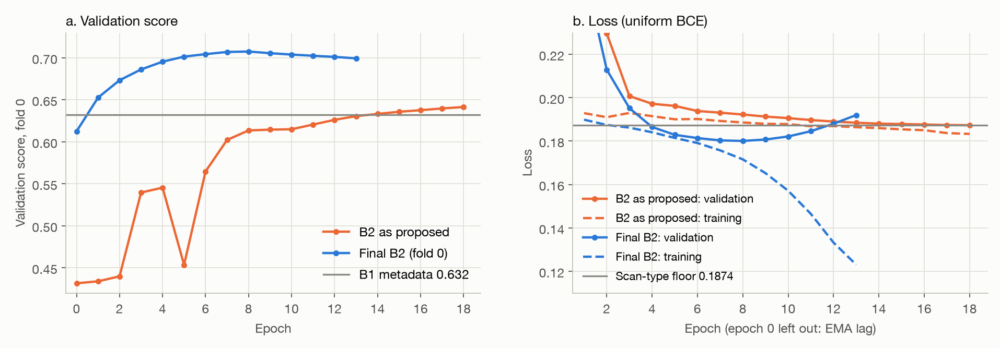
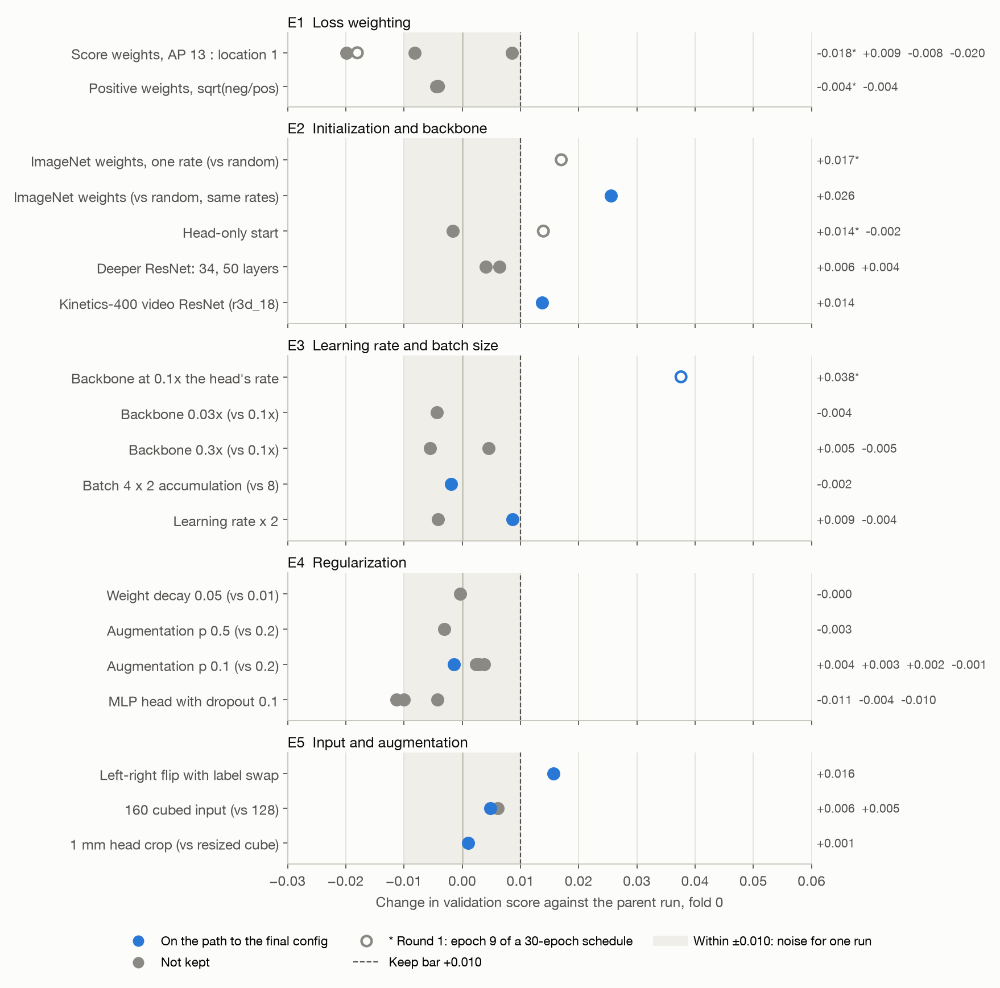
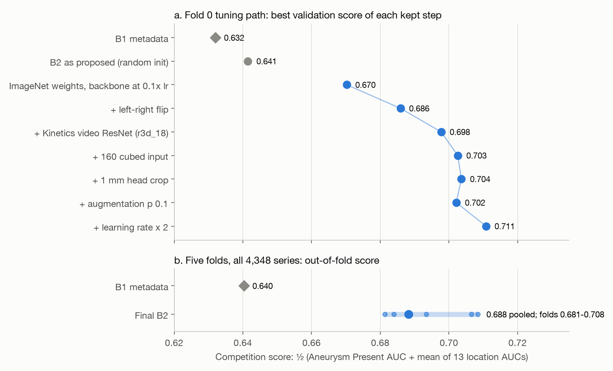
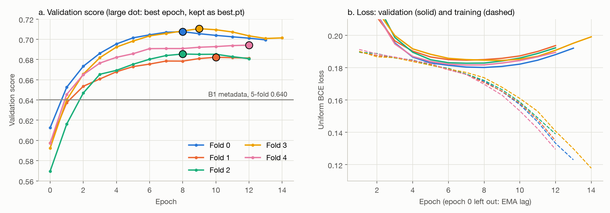
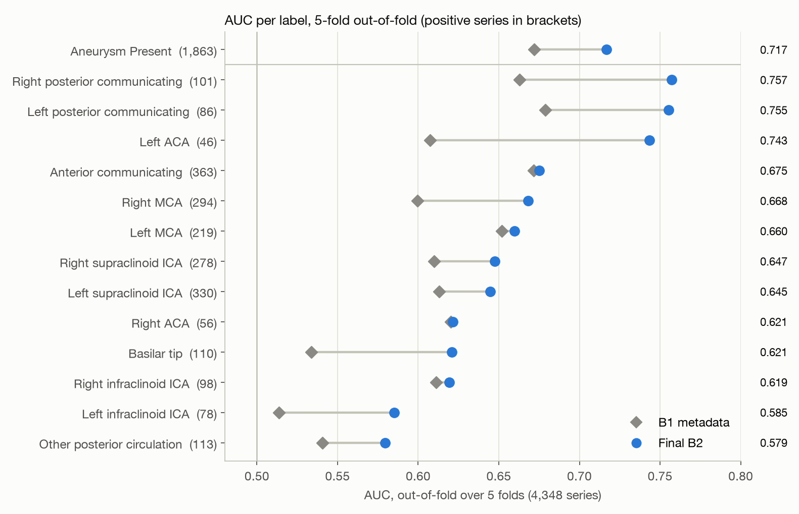
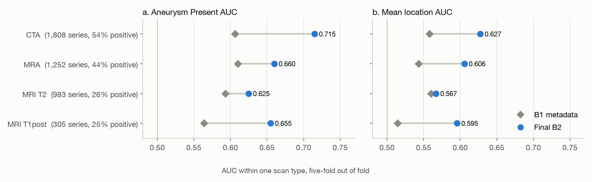
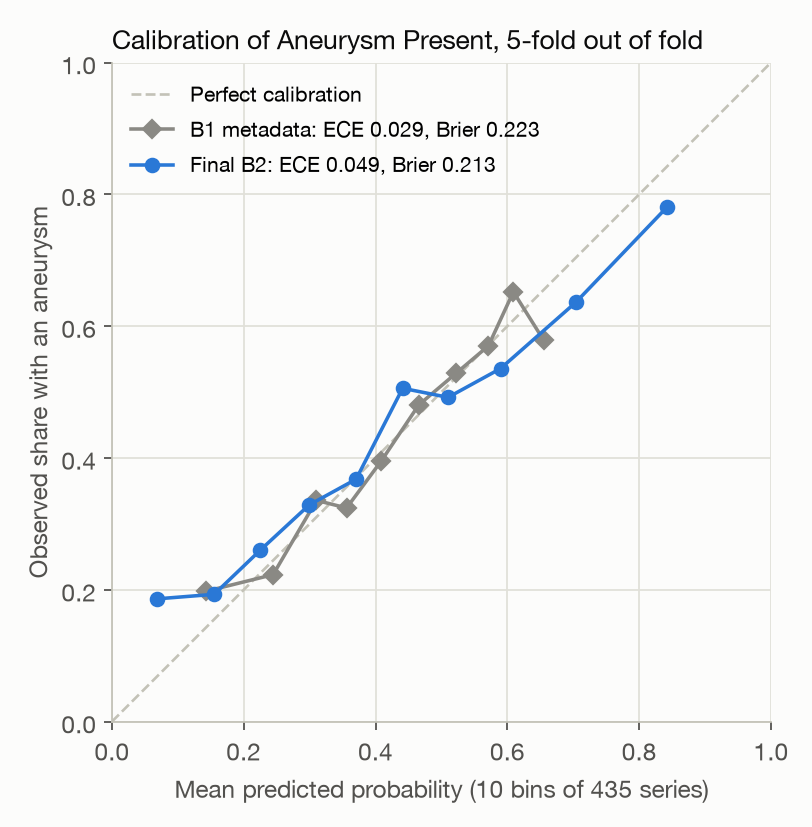
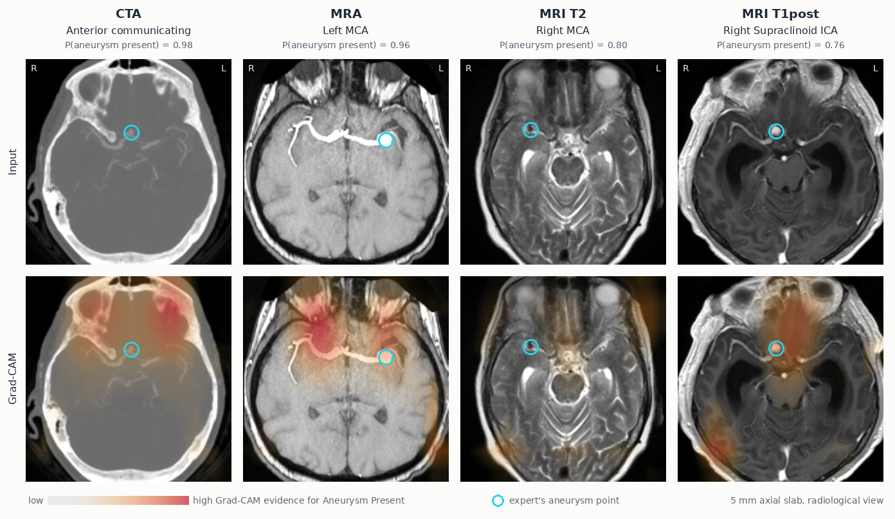

# Neuro-Vision: midterm checkpoint

**AAI 6640 Applied Deep Learning · Final project, Stages 1 and 2 · Northeastern University**

| | |
|:--|:--|
| Group members | Muhammad Obaidullah · Pichpisey Piseth · Emmanuel Matthews |
| Instructor | Prof. Dr. Behnaz Merikhi |
| Due | November 8, 2026 |
| Report | [W&B report](https://forge.coreweave.com/wandb/muhammadobaidullah98-northeastern-university/neuro-vision/reports/Neuro-Vision-midterm-checkpoint--VmlldzoxODIzOTI4Nw) (this document plus live run panels) |
| Data | [RSNA Intracranial Aneurysm Detection](https://www.kaggle.com/competitions/rsna-intracranial-aneurysm-detection): 4,348 training series, 311 GB of DICOM |

Neuro-Vision is a 3D CNN that reads one brain scan and returns 14 probabilities: is an intracranial
aneurysm present, and on which of 13 arteries.

| Stage | Result |
|:--|:--|
| 1 · Baseline | The proposed 3D ResNet-18 (B2) scored 0.641 on fold 0, level with metadata alone (B1, 0.632). Its loss settled at the floor set by scan type: it had learned the scan type, not the aneurysm. |
| 2 · Optimization | 37 runs on fold 0, nearly all changing one setting of a named parent. Pretrained weights, a lower backbone learning rate, a left–right flip and a video backbone gave the gains; loss weighting and regularization did not. Fold 0 rose to 0.711. |
| Final baseline | On all 4,348 series over five folds, the tuned B2 scores **0.688** out of fold, against 0.640 for B1 (+0.048, 95% CI 0.035 to 0.062). |
| 3 · Next | Arm A: find the vessel region and read it at finer resolution. Locations are the weak half of the score, and Grad-CAM shows the model's evidence is not on the aneurysm. |

## 1 Progress overview

### 1.1 Status

| Work item | Status | Evidence |
|:--|:--|:--|
| Data download and audit | Done | 4,348 series, no missing values: `results/audit.json` |
| Corrected labels | Done | 7 cells in 4 series changed: `data/manifests/labels.yaml` |
| Leakage check and folds | Done | Header audit `results/headers.json`; folds `data/manifests/folds.yaml` |
| Competition metric | Done | Matches Kaggle's code to 1e-6: `tests/test_metric.py` |
| Stage 1: B0, B1, B2 as proposed | Done | `results/b0.json`, `results/b1.json`; W&B run `b2-lr3e-4-bs8-fold0` |
| Stage 2: controlled experiments | Done | 37 fold-0 runs; W&B tags `round1` and `tune` |
| Final baseline on five folds | Done | `results/b2.json`; W&B group `b2_final` |
| Diagnostics | Done | `results/b2_diagnostics.json`; Section 5 |
| Stage 3: arm A | Next | Section 7 |
| Kaggle late submission | Planned for week 13 | Run once, on the final models |

### 1.2 Changes since the proposal

| Area | Proposal | Now | Reason |
|:--|:--|:--|:--|
| Folds | 5-fold cross-validation | Grouped by FrameOfReferenceUID, so the 672 multi-series sessions stay in one fold | Instructor feedback on patient overlap. PatientID is unique per series, so no patient key exists. |
| Loss | Score weights: Aneurysm Present 13, each location 1 | Uniform binary cross-entropy | Instructor feedback asked for a justification. Score weights then lost in 3 of 4 tests (E1). |
| Pretrained weights | Med3D, as a Stage 2 option | ImageNet ResNet-18 inflated to 3D [3], then the Kinetics-400 [8] video ResNet r3d_18 [7] | Public torchvision weights, pinned by SHA-256 (`data/manifests/weights.yaml`). Random init learned only the scan type (Section 3). |
| Input | Whole head resized to 128³ | 1 mm voxels, a 160 mm crop on the head, 160³ | A cube resize ignores voxel spacing; CTA keeps the neck and table (E5). |
| Labels | `train.csv` | Corrected labels from the artery masks of Shi et al. [4] | 7 cells were wrong, 2 of them left–right swaps. |
| Deliverable | One notebook | This repository plus the W&B report | Agreed with the instructor. |
| Compute | About 78 H200-hours, unvalidated | 26 GPU-hours of epoch time, mostly on L40S cards | Summed from each run's per-epoch times. Stage 3 fits the remaining budget. |

## 2 Team participation and individual contribution

The meeting record (Table 1) and the contribution summary (Table 2) are in Section 2 of the
[W&B report](https://forge.coreweave.com/wandb/muhammadobaidullah98-northeastern-university/neuro-vision/reports/Neuro-Vision-midterm-checkpoint--VmlldzoxODIzOTI4Nw).

## 3 Stage 1: baseline

### 3.1 Data and preprocessing

| Step | Setting | Result |
|:--|:--|:--|
| Read | pydicom; slices ordered by position [1, 2] | 4,348 series; CTA 1,808 · MRA 1,252 · MRI T2 983 · MRI T1post 305 |
| Geometry check | One orientation, no slice gaps, enough slices | 4,311 pass. 37 fail (19 mixed orientation, 15 slice gaps, 3 other) and receive the label prior. |
| Orientation | Reoriented to RAS | 322 multi-frame MR series lack per-slice orientation; all 322 match their true axes. |
| Resample, as proposed | Whole scan resized to 128³ with antialiasing | Median voxel side 1.8 mm (90th percentile 3.0 mm) |
| Intensity | Clip at the 0.5th and 99.5th percentiles, then z-score per series | |
| Augmentation | Each with probability 0.2: noise, gamma, rotation ±10°, scale ±10%, low-resolution zoom | Training only |

Labels are multi-label: Aneurysm Present is 1 when any of the 13 locations is 1. 1,863 series
(42.8%) are positive. Rare locations have 46–113 positives in total. Details: [dataset.md](dataset.md).

### 3.2 Splits

- **Train and validation.** Five folds, stratified by Aneurysm Present × scan type. Series that share
  a FrameOfReferenceUID (one scanning session) share a fold: 3,509 groups, the largest of 5.
- **Fold size.** 869–870 series per fold, 42.8–42.9% positive. Each series is validated once, so the
  five folds give out-of-fold (OOF) predictions for all 4,348 series.
- **Test.** Kaggle's hidden test set, about 2,500 series [1], scored once by late submission. No internal
  test split: the rarest arteries have only 6–16 positives per fold.
- **Stage 2** tuned on fold 0 only: 3,478 training series (30 fail preprocessing) and 870 validation.

### 3.3 Reference baselines

| Baseline | Inputs | 5-fold score | Fold-0 score | Purpose |
|:--|:--|--:|--:|:--|
| B0 | None: one constant prior | 0.500 | 0.500 | Floor check for the scorer |
| B1 | Age, sex and scan type; gradient boosting | 0.640 | 0.632 | What metadata alone earns. An image model must beat it. |

### 3.4 B2 as proposed

| Item | Setting |
|:--|:--|
| Architecture | MONAI [6] 3D ResNet-18 [3]: 7³ stem, 4 stages × 2 residual blocks (64–512 channels), BatchNorm, global average pool, linear 512 → 14; 33.2 M parameters |
| Activations | ReLU inside the network; one sigmoid per output, since a series can carry up to 5 locations |
| Loss | Binary cross-entropy, uniform over the 14 labels |
| Optimizer and schedule | AdamW [9], learning rate 3e-4, weight decay 0.01; 1 warm-up epoch, then cosine decay |
| Batch and epochs | Batch 8; up to 30 epochs; stop after 5 epochs without a lower validation loss |
| Other settings | Random init; EMA of weights (decay 0.999); bf16 training, fp32 prediction; the epoch with the best validation score is kept |
| Cost | 140 s training and 15 s validation per epoch on one L40S |

A first run at learning rate 1e-4 and batch 2 × 4 climbed more slowly (0.634 at epoch 15), so
3e-4 and batch 8 became the reference.

### 3.5 Metrics

- **Primary:** the competition score, ½ × (Aneurysm Present AUC + mean of the 13 location AUCs).
  A rare artery counts as much as a common one.
- **Secondary:** Aneurysm Present AUC, mean location AUC, AUC per label and per scan type.
- **Scan-type floor:** the loss of predicting each scan type's base rate, 0.1874 on fold 0. A
  model whose loss stays there has learned only the scan type.
- **Beyond AUC:** sensitivity, specificity and calibration of Aneurysm Present (Section 5).

### 3.6 Results and learning curves

*Figure 1. Fold 0. (a) Validation score per epoch. (b) Loss; the gray line is the scan-type floor.
Source: `history.csv` of each run.*

<!-- wandb: stage1 -->

| Model | Fold-0 score | Best epoch | Lowest validation loss | Training loss at the end |
|:--|--:|--:|--:|--:|
| B1 metadata | 0.632 | n/a | n/a | n/a |
| B2 as proposed | 0.641 | 18 of 19 (stopped) | 0.1873, at the floor | 0.183 |

What this shows:

- **B2 as proposed underfits.** Training loss (0.183) and validation loss (0.1873) both sit near
  the scan-type floor (0.1874). The model learned nothing beyond the scan type.
- **The task is hard for a whole-head model.** At 1.8 mm voxels a 5 mm aneurysm spans about three
  voxels, and most voxels lie outside the arteries.
- **The data are clean.** No values are missing, 99.1% of series pass preprocessing, and the
  orientation check passed. The main confound is scan type: 54% of CTA series are positive, against
  25–26% of MRI series.
- **The design suits the task; the start point did not.** A series-level 3D CNN needs no box labels
  and serves cross-validation and Kaggle through one path. From a random start it did not find the
  aneurysm signal in the fold-0 training set. Stage 2 tests why.

## 4 Stage 2: optimization experiments

### 4.1 Protocol

| Item | Rule |
|:--|:--|
| Data | Fold 0; the same folds, scorer and trainer for every run |
| Change | One variable against a named parent config, enforced by a test |
| Length | 10 epochs, cosine schedule to zero, no early stop. Round 1 used the 30-epoch schedule and compares epoch 9. |
| Measure | Best validation score over the epochs, which selects `best.pt`; the final-epoch score guards against a lucky peak |
| Keep rule | Best score at least +0.010 over the parent and a higher final score. Later, smaller gains were stacked and judged as a stack. |
| Noise | Paired bootstrap 95% interval for two related runs: about ±0.010 |
| Cost | 11–48 minutes of epoch time per run; a 160³ run takes 1.9 × as long as a 128³ run |
| Tracking | One W&B run per experiment; configs in `configs/stage2/` and `configs/tune/`. Epochs count from 0. |

### 4.2 Five experiments

*Figure 2. Each dot is one run against its parent, fold 0. Blue: on the path to the final config.
Hollow: round 1, compared at epoch 9 of a 30-epoch schedule. Source: `history.csv` of each run.*

Each experiment answers a question raised by the model's behavior. Values are changes in fold-0
score against the parent run. Learning curves for every run sit beside each experiment in the W&B
report.

**E1 Loss weighting.** The score gives Aneurysm Present half its weight; a uniform loss gives it
1/14.

| Changed | Held constant | Result |
|:--|:--|:--|
| Score weights (Aneurysm Present 13, each location 1), tested on four parents | All other settings of each parent | −0.018, +0.009, −0.008, −0.020 |
| Positive weights √(negatives / positives) per location, 3–10 | As above | −0.004, −0.004 |

Uniform loss stays. With positive weights, validation loss rose from epoch 5 while training loss
fell: the model memorized rare positives.

<!-- wandb: e1 -->

**E2 Initialization and backbone.** B2 sat at the scan-type floor; pretrained filters could start
it from useful features.

| Changed | Held constant | Result |
|:--|:--|:--|
| ImageNet ResNet-18 inflated to 3D, against random init | One learning rate | +0.017 (round 1) |
| ImageNet against random init | Backbone at 0.1 × the head's rate for both | +0.026 (95% CI 0.003 to 0.047) |
| Head only for the first epochs | ImageNet start | +0.014 (2 epochs, round 1); −0.002 (1 epoch) |
| ResNet-34, ResNet-50 against ResNet-18 | ImageNet start, flip, batch 4 × 2 | +0.006, +0.004; ResNet-50 takes 1.9 × the time |
| Kinetics-400 video ResNet r3d_18 [7] against ImageNet ResNet-18 | Flip, batch 4 × 2, 128³ | +0.014 |

Starting weights gave the largest gains. Video weights beat deeper ImageNet ResNets. r3d_18 also
has its own stem, so its weights and its layout are not separated.

<!-- wandb: e2 -->

**E3 Learning rate and batch size.** Pretrained filters need a gentler rate than a new head.

| Changed | Held constant | Result |
|:--|:--|:--|
| Backbone at 0.1 × the head's rate, against one rate | ImageNet start | +0.038 (round 1); the first run below the scan-type floor |
| Learning rate 1e-3 instead of 3e-4 | Random init, score weights | −0.003 (round 1, epoch 8); unstable, 0.47–0.49 at epochs 1–5 |
| Backbone at 0.03 × instead of 0.1 × | ImageNet start | −0.004 |
| Backbone at 0.3 × instead of 0.1 × | ImageNet start; flip run | +0.005; −0.005 |
| Batch 4 × 2 accumulation instead of 8 | Effective batch 8 | −0.002, neutral; lets 160³ fit one 48 GB card |
| Learning rate × 2 (head 6e-4, backbone 6e-5) | r3d_18 at 160³ | +0.009 with the head crop; −0.004 without |
| Batch 16 at learning rate 1.2e-3 (two settings) | Best config | −0.012 to −0.022 at epochs 0–2; stopped |

A 0.1 × backbone rate is kept. Twice the rate helped only with the head crop, on one seed, so the
split may be noise. It stays because that run was the best on fold 0, and five folds confirmed the
config as a whole (Section 4.4).

<!-- wandb: e3 -->

**E4 Regularization.** ImageNet runs overfit after epoch 5: training loss fell from 0.164 to 0.103
while validation loss rose.

| Changed | Held constant | Result |
|:--|:--|:--|
| No augmentation | Random init, score weights | −0.112 (round 1, epoch 5); validation loss rises from epoch 3 |
| Weight decay 0.05 instead of 0.01 | ImageNet reference | −0.000; no effect at these learning rates |
| Augmentation probability 0.5 instead of 0.2 | ImageNet reference | −0.003; training loss 0.140 instead of 0.103 |
| Augmentation probability 0.1 instead of 0.2 | Four parents | +0.004, +0.003, +0.002, −0.001 |
| MLP head (512 → 256 → 14, LayerNorm, dropout 0.1) | Three parents | −0.011, −0.004, −0.010 (stopped after 9 epochs) |

In these 10-epoch tests, less overfitting did not raise the AUC. The final run limits overfitting
with early stopping on validation loss and best-epoch selection.

<!-- wandb: e4 -->

**E5 Input and augmentation.** Locations were the weak half (0.622 on the ImageNet reference), the
left side weakest.

| Changed | Held constant | Result |
|:--|:--|:--|
| Left–right flip, probability 0.5, with left and right labels swapped | ImageNet reference | +0.016 (95% CI 0.006 to 0.027); location AUC 0.622 → 0.648 |
| 160³ input instead of 128³ | ResNet-18; r3d_18 | +0.006; +0.005 |
| 1 mm voxels and a 160 mm head crop instead of a resized cube | r3d_18 at 160³ | +0.001 best, +0.000 final; +0.010 to +0.013 at epochs 0–1 |

The flip is the largest input gain: it doubles the examples per side. Finer whole-head input adds
0.006 or less.

<!-- wandb: e5 -->

### 4.3 Path to the final baseline

*Figure 3. (a) Best fold-0 score of each kept step; the r3d_18 step and later ones use batch 4 × 2 (neutral).
B2 as proposed ran 19 epochs of a 30-epoch schedule; the other steps ran 10 epochs.
(b) Out-of-fold score over all five folds; small dots are single folds.*

| Step | Fold-0 score | Change |
|:--|--:|--:|
| B2 as proposed | 0.641 | |
| ImageNet weights, backbone at 0.1 × the rate | 0.670 | +0.029 |
| + left–right flip | 0.686 | +0.016 |
| + Kinetics-400 r3d_18 (batch 4 × 2) | 0.698 | +0.012 |
| + 160³ input | 0.703 | +0.005 |
| + 1 mm head crop, then augmentation 0.1, then learning rate × 2 (three runs) | 0.711 | +0.008 |

<!-- wandb: path -->

### 4.4 Final baseline on five folds

| Item | Setting |
|:--|:--|
| Config | `configs/final/b2_final.yaml`, commit `c8a69e2` |
| Model and input | r3d_18 with Kinetics-400 weights, 33.2 M parameters; 1 mm head crop at 160³ |
| Training | Uniform BCE; AdamW, head 6e-4 and backbone 6e-5; batch 4 × 2; flip; augmentation 0.1; up to 30 epochs, early stop after 5 without a lower validation loss |
| Checkpoint | EMA weights of the epoch with the best validation score (`best.pt`) |
| Cost | 285 s per epoch on one L40S; 5.4 GPU-hours of epoch time for five folds |

| Fold | Epochs run | Best epoch | Score | Aneurysm Present AUC | Mean location AUC |
|--:|--:|--:|--:|--:|--:|
| 0 | 14 | 8 | 0.707 | 0.741 | 0.672 |
| 1 | 13 | 10 | 0.681 | 0.720 | 0.643 |
| 2 | 13 | 8 | 0.684 | 0.698 | 0.670 |
| 3 | 15 | 9 | 0.708 | 0.734 | 0.683 |
| 4 | 13 | 12 | 0.693 | 0.709 | 0.678 |
| Mean (sd) | | | 0.695 (0.013) | | |
| **Pooled out of fold, 4,348 series** | | | **0.688** | **0.717** | **0.660** |

Scores come from each fold's `oof.csv`, which includes the 5–9 series per fold that fail
preprocessing. `history.csv` skips them and reads up to 0.003 higher.

| Model | Score | Aneurysm Present AUC | Mean location AUC |
|:--|--:|--:|--:|
| B1 metadata | 0.640 | 0.672 | 0.609 |
| **Final B2** | **0.688** | **0.717** | **0.660** |
| Difference (paired bootstrap 95% CI) | +0.048 (0.035 to 0.062) | +0.045 (0.029 to 0.061) | +0.051 (0.035 to 0.069) |

On fold 0 the 30-epoch run scores 0.707, against 0.711 in its 10-epoch screen: the schedule
differs, and `oof.csv` includes the prior-filled series. The bootstrap resamples the 4,348 series
2,000 times; no resample puts B2 at or below B1. Sources:
`results/b1.json`, `results/b2.json`, `results/b2_diagnostics.json`.

<!-- wandb: final -->

## 5 Generalization and diagnostics

### 5.1 Learning curves

*Figure 4. Final B2, five folds. (a) Validation score; the large dot marks `best.pt`. (b)
Validation loss (solid) and training loss (dashed). Source: `history.csv` of each fold.*

- **Convergence.** On fold 0, validation loss falls below the scan-type floor at epoch 4. On every
  fold it is lowest at epochs 7–9 (0.180–0.185).
- **Overfitting after epoch 9.** Training loss keeps falling, from about 0.17 to 0.12–0.14, while
  validation loss rises to 0.189–0.199. Early stopping ended every fold after 13–15 epochs.
- **Little cost to the score.** The score peaks at epochs 8–12 and slips by at most 0.010 after.
  This matches E4: regularization moved the loss, not the AUC.

### 5.2 Stability

- **Folds differ by 0.027** (0.681–0.708, sd 0.013), more than most single Stage 2 steps. B1
  varies as much (sd 0.013), so the spread comes from the folds, not the model. Future changes are
  judged on five folds, not fold 0 alone.
- **The tuning gain transfers, with some optimism.** Folds 1–4 played no part in tuning and average
  0.692, against 0.707 on fold 0.
- **The pooled score sits below the fold mean** (0.688 against 0.695). Pooling ranks the outputs
  of five models together; a likely cause is small calibration shifts between them (untested).

### 5.3 Per label

*Figure 5. AUC per label over all 4,348 series; positive series in brackets. Source:
`results/b1.json`, `results/b2.json`.*

- **B2 beats B1 on all 14 labels,** but by less than 0.01 on four: Right ACA, Right infraclinoid
  ICA, Left MCA and Anterior communicating.
- **Strongest:** both posterior communicating arteries (0.757, 0.755) and Left ACA (0.743).
- **Weakest:** Other posterior circulation (0.579) and Left infraclinoid ICA (0.585).
- **Rare labels are noisy.** Left ACA has 46 positives in total, 8–11 per fold.

### 5.4 Per scan type

*Figure 6. AUC within each scan type over all five folds. Within one type, B1 can use only age and
sex. Source: `results/b2_diagnostics.json`.*

- **B2 beats B1 within every scan type,** on both halves of the score, so its gain does not come
  from scan type alone. The one exception in size is MRI T2 locations (below).
- **Within-type AUCs sit below the pooled ones.** Pooled AUCs also rank across scan types, whose
  base rates differ (54% positive on CTA, 26% on MRI T2).
- **CTA is strongest** (Aneurysm Present 0.715). **MRI T2 is weakest** (0.625; locations 0.567
  against 0.560 for B1, within noise). T2 slices sit 5 mm apart ([dataset.md](dataset.md)), so an
  aneurysm spans one or two slices.

### 5.5 Beyond AUC: operating point and calibration

| Aneurysm Present, out of fold | Threshold | Sensitivity | Specificity | PPV | NPV | F1 |
|:--|--:|--:|--:|--:|--:|--:|
| B2 at the Youden point | 0.41 | 0.682 | 0.652 | 0.595 | 0.732 | 0.636 |
| B2 at sensitivity 0.90 | 0.20 | 0.900 | 0.311 | 0.495 | 0.806 | 0.639 |
| B1 at the Youden point | 0.44 | 0.662 | 0.613 | 0.562 | 0.707 | 0.608 |
| B1 at sensitivity 0.90 | 0.28 | 0.902 | 0.276 | 0.483 | 0.790 | 0.629 |

Confusion counts for B2 at the Youden point: 1,271 true positives, 866 false positives, 1,619 true
negatives, 592 false negatives.

*Figure 7. Observed share of aneurysm series against the mean predicted probability, in 10
equal-count bins. Source: `results/b2_diagnostics.json`.*

- **B2 finds 68% of aneurysm series and clears 65% of the others** at its best balanced threshold.
- **It is not a screening tool yet.** To catch 90% of aneurysm series it flags 69% of the rest.
- **Probabilities are too extreme.** The lowest bin predicts 0.068 against 0.186 observed; the
  highest predicts 0.843 against 0.781. B2 has the better Brier score (0.213 against 0.223) but the
  worse calibration error (ECE 0.049 against 0.029). AUC ignores this; any reported threshold needs
  calibrated probabilities.

### 5.6 Where the model looks

*Figure 8. Grad-CAM [10] for Aneurysm Present. One held-out positive per scan type: the most
confident correct positive whose aneurysm lies inside the crop, read by the fold model that never
trained on it. Top: 5 mm axial slab. Bottom: Grad-CAM overlay. Ring: the expert's aneurysm point.
Source: `scripts/gradcam_examples.py`.*

| Pointing test: 1,835 held-out positives | Grad-CAM peak | Random head voxel | Mean aneurysm position |
|:--|--:|--:|--:|
| Within 20 mm of the expert's point | 1.7% | 1.9% | 39.6% |
| Median distance | 103 mm | n/a | 23 mm |

- **The evidence does not sit on the aneurysm.** The Grad-CAM peak lands near the expert's point
  as rarely as a random voxel in the head. A single fixed point does twenty times better.
- **Even confident, correct calls look elsewhere:** frontal bone and orbits on CTA, anterior vessels
  on MRA, a weak diffuse map on T2.
- **Caveat:** the last stage is a 20 × 10 × 10 grid (cells of about 8 × 16 × 16 mm), so the maps
  are coarse. Coarse maps can still point to the right region; these do not.
- **Implication:** B2's evidence for an aneurysm comes mostly from outside it. This is the strongest
  case for arm A, which removes most of the head from the input.

### 5.7 What the diagnostics decide

| Finding | Decision |
|:--|:--|
| Locations trail Aneurysm Present (0.660 against 0.717) | Stage 3 targets locations: the model must see the arteries in detail |
| Grad-CAM peaks fall near the aneurysm no more often than chance (5.6) | Arm A restricts the input to the vessel region; the pointing test is repeated on arm A |
| Finer whole-head input added 0.006 or less (E5) | More voxels of the whole head do not help; more voxels of the vessel region may |
| Starting weights gave the largest gains (E2) | Arm A keeps the Kinetics-400 r3d_18 and the final recipe; only the input changes |
| Overfitting costs little AUC (5.1, E4) | No new regularization; keep early stopping and best-epoch selection |
| The gain holds within every scan type; MRI T2 is weakest (5.4) | Report arm A per scan type; T2 tests whether finer crops help thick slices |
| Probabilities are overconfident at both ends (5.5) | Calibrate on out-of-fold predictions before any threshold is reported |
| Fold spread exceeds most tuning steps (5.2) | Judge arm A on five folds with a paired bootstrap against B2 |

### 5.8 Limits of this evidence

| Limit | Effect |
|:--|:--|
| Tuned on fold 0, one seed per run | Most steps of 0.002–0.006 sit inside the ±0.010 noise band. The five-fold run confirms the config as a whole, not each step. |
| Best epoch chosen on the scored fold | OOF scores are slightly optimistic, the same way for every model. |
| 10-epoch screening | Favors fast learners; random init was still rising at epoch 9. |
| No patient key | The same patient across visits cannot be linked. 532 series lack FrameOfReferenceUID and form their own groups. |
| 37 series fail preprocessing | They receive the label prior; `history.csv` scores skip them and read up to 0.003 high. |
| Orientation of a few volumes | A mirror-symmetry check flags 53 of 4,311 cached volumes whose axes may be swapped. The check is a heuristic; the series are not yet verified one by one. |
| Scan type confounds the label | Pooled AUCs include ranking across scan types; within-type scores are 0.596–0.671 (Section 5.4). |

## 6 Challenges and mitigation

| Challenge | Effect on the project | Response | Worked? | Still needed |
|:--|:--|:--|:--|:--|
| Data scale: 311 GB of DICOM, four scan types | Preprocessing is the slowest step | Resumable CPU jobs in 1-hour pieces; cached volumes; one index of every failure | Yes: 4,311 of 4,348 cached | A new crop cache for arm A |
| No patient identifier | Train and validation could share a patient | FrameOfReferenceUID groups 1,511 series into 672 sessions | Partly: 532 series lack the tag | Compare the five-fold and Kaggle scores |
| Orientation of stripped multi-frame MR | Left and right labels could flip | Assumed axes checked against the true orientation | Yes: 322 of 322 match | Verify the 53 volumes a symmetry check flags (Section 5.8) |
| B2 stuck at the scan-type floor | The proposed baseline only matched metadata | Diagnosed with the floor loss; pretrained start and a lower backbone rate | Yes: +0.07 on fold 0 | None |
| Small gains against run noise | One-seed gains of 0.002–0.006 cannot be trusted | +0.010 keep rule, paired bootstrap, five-fold confirmation | Partly | Seed replicates of the final config |
| GPU queues and limits | H200 waits of hours; 1-hour limit and 2 running jobs on the open partition | L40S cards in resumable 1-hour pieces; any free GPU type | Yes: 26 GPU-hours, no lost run | None |
| Scratch purges | Monthly deletion on /scratch | Purge dates checked by the submit script; results committed as aggregates | Partly: the final run overlapped the November window by choice | Copy finalist weights off /scratch before December 1 |

## 7 Reflection and forward plan

### 7.1 Reflection

The proposed baseline matched metadata, and its validation loss sat at the scan-type floor. That
diagnosis set the course of Stage 2: the network had to learn something beyond the scan type
before any tuning could matter.

Four changes gave most of the gain. Pretrained weights beat random init by 0.026 at the same
learning rates. A backbone rate of 0.1 × the head's added 0.038 in round 1. The left–right flip
with label swap added 0.016. The Kinetics-400 video ResNet added 0.014 over ImageNet ResNet-18;
its stem also differs, so weights and layout are not separated. Loss weighting and regularization
did not move the score. Score-weighted loss lost in three of four tests, which answers the
instructor's question with evidence.

The returns from tuning the whole-head design are falling. The last two steps added 0.013 on
fold 0, and finer whole-head input added at most 0.006. These are single-seed results, so the
limit is a judgment, not a measurement. Location AUC (0.660) still trails Aneurysm Present (0.717)
by 0.057.

Open problems remain. Seed spread is unmeasured, and each step's gain rests on one fold. MRI T2 is
the weakest scan type, and the probabilities are overconfident at both ends (Section 5).

### 7.2 Stage 3 direction: arm A

**Arm A reads the vessel region, not the whole head.** A 2D detector on sagittal and coronal
maximum-intensity projections (MIPs) finds a 3D box around the circle of Willis [5]. A 120 mm cube
around that box is resampled to 160³. Voxels shrink from 1 mm to 0.75 mm, and most of the head
outside the arteries is cut away.

Why this direction fits the evidence (Section 5.7):

- **Locations are the weak half** of the score, and locating an aneurysm needs detail at the
  arteries.
- **The model does not look at the aneurysm.** Grad-CAM peaks fall near it at chance rate (5.6).
- **More whole-head detail stopped paying:** 160³ and the 1 mm crop added at most 0.006 (E5).
- **The recipe carries over.** Arm A keeps the Kinetics-400 r3d_18, the loss, the schedule and the
  folds. The change is confined to the input: its region, field of view and voxel size. The
  detector is the one new component, and its box recall is measured on its own.
- **It is feasible.** A five-fold run costs about 5.4 GPU-hours of epoch time; the detector about
  1 hour.

Arm B (vessel-guided pooling on a vessel-pretrained encoder) remains a stretch goal.

### 7.3 Remaining work and schedule

| Week | Work | Done when |
|:--|:--|:--|
| 9 (Nov 4–10) | Box labels from the 178 vessel masks; MIP detector | The box holds at least 95% of the 2,254 expert aneurysm points on held-out folds |
| 10 (Nov 11–17) | Crop cache; arm A on fold 0 against the final B2 | One fold-0 result |
| 11 (Nov 18–24) | Arm A on five folds; feature freeze | Paired bootstrap against B2 on all 4,348 series |
| 12 (Nov 25–Dec 1) | Diagnostics for arm A; seeds 1 and 2 of the better model | Seed spread measured |
| 13 (Dec 2–8) | Kaggle late submission of B2 and arm A, once | Private and public scores recorded |
| 14–15 (Dec 9–20) | Ethics presentation; final notebook and demo | Submitted |

Muhammad Obaidullah owns all remaining work. Meetings 4 and 5 (W&B report, Section 2) review the
arm A result before the feature freeze and the final deliverables. Work runs as one-change
experiments on the shared folds, tracked in W&B; each week ends with a committed result and an
updated report.

## References

1. RSNA, "RSNA Intracranial Aneurysm Detection," Kaggle, 2025.
2. M. Correia de Verdier et al., "The RSNA Intracranial Aneurysm (RSNA-ICA) Dataset," arXiv:2610.01135, 2026.
3. K. Hara, H. Kataoka and Y. Satoh, "Can spatiotemporal 3D CNNs retrace the history of 2D CNNs and ImageNet?" CVPR, 2018.
4. P. Shi et al., "Intracranial aneurysm classification and segmentation via tri-axial ROI and multi-task learning," arXiv:2606.26706, 2026. Masks under CC BY-NC 4.0.
5. YYama, TmT, nmst, D. Nagao and bbscience, "3rd place solution," RSNA Intracranial Aneurysm Detection, Kaggle writeup, 2025.
6. M. J. Cardoso et al., "MONAI: An open-source framework for deep learning in healthcare," arXiv:2211.02701, 2022.
7. D. Tran et al., "A closer look at spatiotemporal convolutions for action recognition," CVPR, 2018.
8. W. Kay et al., "The Kinetics human action video dataset," arXiv:1705.06950, 2017.
9. I. Loshchilov and F. Hutter, "Decoupled weight decay regularization," ICLR, 2019.
10. R. R. Selvaraju et al., "Grad-CAM: Visual explanations from deep networks via gradient-based localization," ICCV, 2017.
