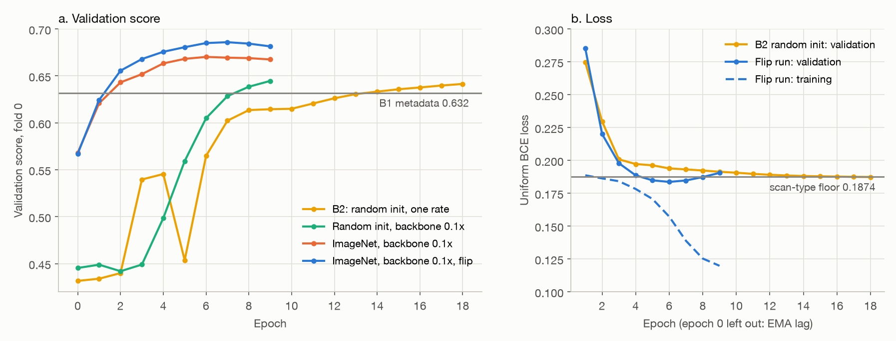
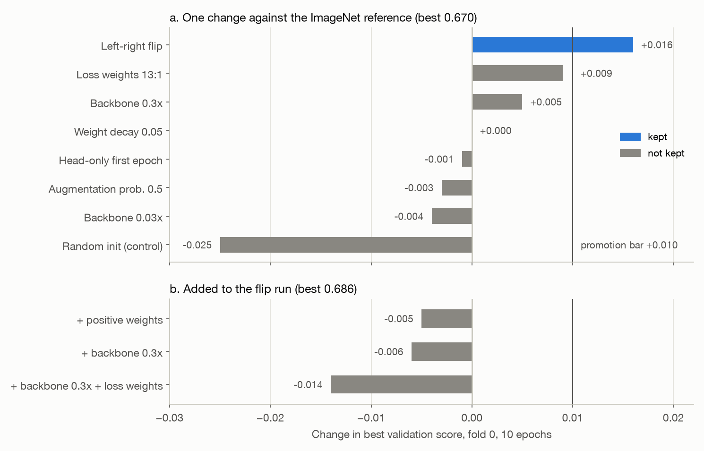
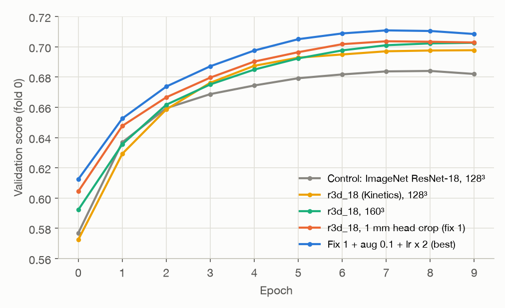
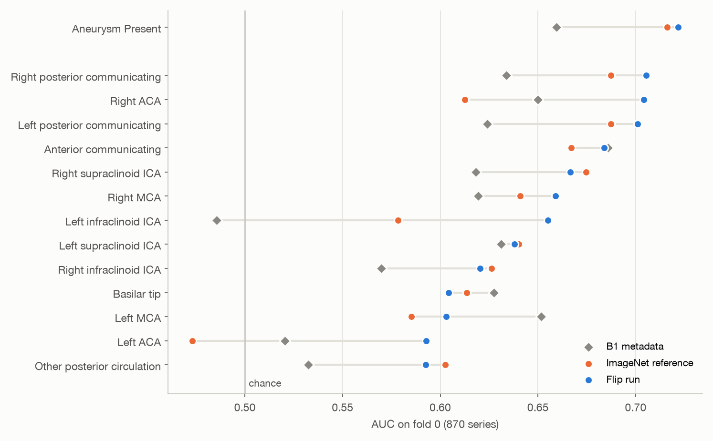
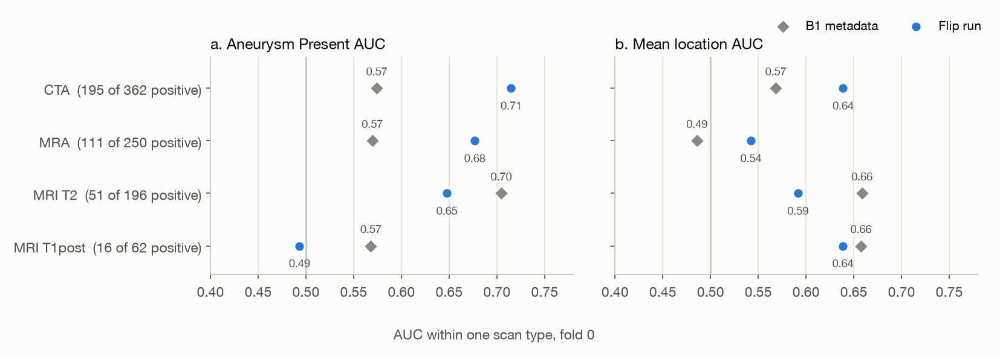
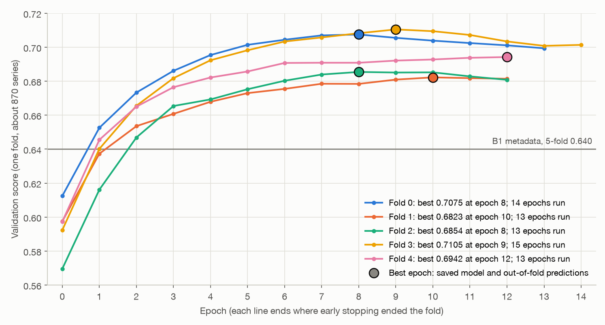

# Neuro-Vision: midterm checkpoint

A 3D CNN reads one brain scan and flags an intracranial aneurysm and its artery. Over all five folds
the image model (B2) scores **0.688**. Metadata alone (B1) scores 0.640, and a constant guess (B0)
0.500. The image model adds +0.048 over metadata on all 4,348 series.

Full report: https://forge.coreweave.com/wandb/muhammadobaidullah98-northeastern-university/neuro-vision/reports/Neuro-Vision:-midterm-checkpoint--VmlldzoxODIzOTI4Nw==

Scores are on fold 0 (870 validation series) unless marked 5-fold or by fold. Figures are in `docs/figures/`.

## 1 Problem and data

Task: from one scan, return 14 probabilities. One is "aneurysm present"; 13 are arteries. Score is the mean of the Aneurysm Present AUC and the mean of the 13 location AUCs.

| Item | Value | Source |
|:--|:--|:--|
| Training series | 4,348 | `results/audit.json` |
| CTA / MRA / MRI T2 / MRI T1post | 1,808 / 1,252 / 983 / 305 | `results/audit.json` |
| Positive series | 1,863 (42.8%) | `results/audit.json` |
| Age | 18-89, median 60 | `results/audit.json` |
| Sex | 3,005 female, 1,343 male | `results/audit.json` |
| Missing values | none | `results/audit.json` |
| Kaggle hidden test | nearly 2,500 series | `results/audit.json` |
| Preprocessed (128³) | 4,311 pass; 37 fail a geometry check and get the label prior | cache index |
| Orientation check | 322 multi-frame series use an assumed orientation; all 322 match the true axes | one-off check, `$NV_STORE/checks/` |

Labels:

- Corrected labels are derived from the 26-class masks of Shi et al. (CC BY-NC 4.0).
- 4 series changed: 7 cells, 2 left-right swaps, no Aneurysm Present change.
- Source: `data/manifests/labels.yaml`.

Scan types, label counts and example scans: [dataset.md](dataset.md).

## 2 Splits and leakage

Headers (header scan; source `results/headers.json`):

| Header | Finding |
|:--|:--|
| PatientID, StudyInstanceUID | Unique per series. Kaggle's data page says they "do not identify anything". |
| FrameOfReferenceUID | Links 1,511 series into 672 same-session groups (largest 5; sex and age agree in every group). Empty for 532. |
| StudyDate | Too coarse: one date covers 316 series. |

Folds (`data/manifests/folds.yaml`):

| Item | Value |
|:--|:--|
| Method | 5 folds, StratifiedGroupKFold by Aneurysm Present x modality |
| Group key | FrameOfReferenceUID (3,509 groups) |
| Seed, labels | 0, corrected |
| Fold size | 869-870 series |
| Positive rate per fold | 42.8-42.9% |
| Thinnest cells (positives per fold) | Left ACA 8-11; Right ACA 6-16; Left infraclinoid ICA 8-28 |

## 3 Stage 1: baselines

| Baseline | Inputs | 5-fold score | 5-fold AP AUC | 5-fold location AUC | Fold-0 score | Fold-0 AP AUC | Fold-0 location AUC |
|:--|:--|--:|--:|--:|--:|--:|--:|
| B0 | Constant prior | 0.500 | 0.500 | 0.500 | 0.500 | 0.500 | 0.500 |
| B1 | Gradient boosting on age, sex, scan type | 0.640 | 0.672 | 0.609 | 0.632 | 0.660 | 0.604 |
| B2 as planned | 3D ResNet-18, random init, uniform BCE | fold 0 only | n/a | n/a | 0.641 (h) | n/a | n/a |
| B2 flip run | + ImageNet weights, backbone at 0.1 x lr, left-right flip | fold 0 only | n/a | n/a | 0.685 | 0.722 | 0.648 |
| **B2 final** | Kinetics r3d_18, 1 mm head crop at 160³, flip, lr x 2 (section 6) | **0.688** | **0.717** | **0.660** | 0.707 (h) | n/a | n/a |

AP = Aneurysm Present. Location AUC = mean of the 13 location AUCs.

Sources: `results/b0.json`, `results/b1.json`, `results/b2.json`. The 5-fold values pool the out-of-fold
predictions of all 4,348 series. Fold-0 values come from each run's `oof.csv` (`best.pt`). (h) marks the two
from `history.csv`: B2 as planned (stopped at epoch 18 of 30) and B2 final (best epoch 8).
`history.csv` skips series that fail preprocessing, so it can read up to 0.003 high (section 7).

B2 setup as planned (the final config changes backbone, input, augmentation, learning rate and batch; section 6):

| Item | Value |
|:--|:--|
| Input | One series at 128³ voxels, RAS, clipped at 0.5-99.5th percentile, z-scored |
| Model | MONAI 3D ResNet-18, 14 outputs; EMA of weights (decay 0.999) |
| Training | AdamW, lr 3e-4, weight decay 0.01, batch 8, 1 warm-up epoch, cosine schedule |
| Augmentation | Probability 0.2 each: noise, gamma, rotation ±10°, scale ±10%, low-resolution zoom |
| Checkpoint | Best epoch by validation competition score |
| Cost | 140 s training + 15 s validation per epoch on one L40S (`meta.json`) |

*Figure 1. Fold-0 training curves. (a) Validation score. The yellow run uses a 30-epoch schedule, stopped at
epoch 18; the others use 10 epochs. (b) Loss. The floor is the loss of predicting each scan type's base
rate. Source: `history.csv` of each run.*

- **B2 as planned only matches B1.** Its validation loss settles at the scan-type floor (0.1873 vs 0.1874). It
  has learned the scan type, not the aneurysm.
- **ImageNet weights break the floor** by epoch 5 (section 4).
- **The image signal is real on fold 0.** Paired bootstrap over the 870 series (2,000 resamples): flip run
  minus B1 = +0.054 (95% CI 0.026 to 0.081).
- **It holds on 5 folds.** B2 final scores 0.688 over all 4,348 series, +0.048 over B1 (section 6).

## 4 Stage 2: focused experiments

Protocol:

| Item | Rule |
|:--|:--|
| Data | Fold 0: 3,448 training series, 870 validation series |
| Length | 10 epochs, cosine schedule, no early stop |
| Changes | One variable per run against its parent config |
| Kept if | Best score at least parent + 0.010, and the final-epoch score also higher. Round 3 (lean plan, user): smaller gains are stacked; the stack is judged as a whole |
| Hardware | One GPU per run, mostly L40S: 18-55 minutes |

**Round 1: what stops B2 from learning?** All runs use the 30-epoch schedule and are compared at epoch 9.

| Run (random init unless noted) | Score at epoch 9 | Finding |
|:--|--:|:--|
| B2: lr 3e-4, uniform BCE | 0.614 | Reference for this round |
| Original B2: lr 1e-4, batch 2 x 4 | 0.623 | Slow climb; 0.634 at epoch 15 |
| Loss weights 13:1 (Aneurysm Present : each location) | 0.596 | Lower |
| Loss weights, lr 1e-3 | 0.589 (epoch 8) | Unstable |
| Loss weights, no augmentation | 0.457 (epoch 5) | Validation loss rises from epoch 3 |
| Loss weights + positive weights √(neg/pos) | 0.592 | Memorizes rare positives |
| ImageNet weights, one rate | 0.631 | Better |
| ImageNet, head only for 2 epochs | 0.645 | Better |
| ImageNet, backbone at 0.1 x lr | **0.669** | First run below the floor (val loss 0.1854) |

**Round 2: tune the ImageNet start.** Reference = ImageNet, backbone at 0.1 x lr, on the 10-epoch
protocol.

*Figure 2. Round 2 results. (a) One change against the reference. (b) Changes added to the flip run.
Source: the experiment log (from `history.csv`).*

| Run | Question | Best (epoch) | Final | Decision |
|:--|:--|--:|--:|:--|
| Reference | ImageNet, backbone at 0.1 x lr | 0.670 (6) | 0.668 | Reference |
| Random init | Is the gain the weights or the lower backbone rate? | 0.645 (9) | 0.645 | Weights help |
| Backbone 0.03 x lr | Should pretrained filters barely move? | 0.666 (7) | 0.665 | Too cautious |
| Backbone 0.3 x lr | Is 0.1 x too cautious? | 0.675 (9) | 0.675 | Under the bar |
| Weight decay 0.05 | Does decay curb the late overfit? | 0.670 (7) | 0.666 | No effect |
| Head-only first epoch | Does it protect the pretrained filters? | 0.669 (7) | 0.664 | No effect |
| Augmentation probability 0.5 | Does more augmentation curb the overfit? | 0.667 (7) | 0.664 | Less overfit, same AUC |
| Loss weights 13:1 | Should the loss match the score's weights? | 0.679 (6) | 0.674 | Under the bar |
| **Left-right flip** | Mirror the head and swap left/right labels: twice the examples per side | **0.686 (7)** | **0.681** | **Kept** |
| Flip + backbone 0.3 x lr | Do the two gains stack? | 0.680 (9) | 0.680 | Below flip alone |
| Flip + backbone 0.3 x + loss weights | Do three gains stack? | 0.672 (9) | 0.672 | Below flip alone |
| Flip + positive weights | Do rare locations need more weight? | 0.681 (7) | 0.681 | Below flip alone |

Findings:

- **Only the flip clears the bar:** +0.016 best, +0.014 final. Paired bootstrap: +0.016 (95% CI 0.006 to 0.027).
- **The ImageNet weights matter,** not just the lower backbone rate: +0.026 over random init (95% CI 0.003 to 0.047).
- **No stack beats the flip alone.** The +0.005 of backbone 0.3 x was noise.
- **Overfitting is not the main limit.** Weight decay, more augmentation and a frozen start leave the AUC unchanged.
- **Loss weighting does not help** (Oct 19 feedback). Score weights gave +0.009 alone and -0.008 on a stack.
  Uniform BCE stays.
- **Post-processing dropped:** multiplying each location by the Aneurysm Present probability gained +0.006 on
  the reference but +0.002 on the flip run.

**Round 3: backbone, input size, learning rate.** All runs keep the flip at batch 4 x 2 (effective 8, so 160³
fits on one card). Gain is against the parent in brackets. Source: `history.csv`.

| Run (parent) | Change | Best (epoch) | Final | Gain best / final | Decision |
|:--|:--|--:|--:|--:|:--|
| Control (flip run) | Batch 4 x 2 | 0.684 (8) | 0.682 | -0.002 / 0.000 | Reference |
| ResNet-34 (control) | Deeper ImageNet ResNet | 0.690 (8) | 0.688 | +0.006 / +0.006 | Small |
| ResNet-50 (control) | Deeper; 1.9 x the epoch time | 0.688 (8) | 0.687 | +0.004 / +0.005 | Small |
| r3d_18 (control) | Video ResNet-18 with Kinetics-400 weights | 0.698 (9) | 0.698 | +0.014 / +0.016 | **Kept** |
| 160³ (control) | Whole scan resized to 160³ | 0.690 (9) | 0.690 | +0.006 / +0.008 | Kept |
| r3d_18 160³ (r3d_18) | 160³ | 0.703 (9) | 0.703 | +0.005 / +0.005 | Kept |
| + aug 0.1 (r3d_18 160³) | Augmentation probability 0.2 to 0.1 | 0.705 (9) | 0.705 | +0.002 / +0.002 | Kept |
| Fix 1 (r3d_18 160³) | 1 mm head crop (below) | 0.704 (7) | 0.703 | +0.001 / 0.000 | Level |
| Fix 1 + aug 0.1 (fix 1) | Augmentation probability 0.1 | 0.702 (7) | 0.699 | -0.002 / -0.004 | Lower |
| **Fix 1 + aug 0.1 + lr x 2** (fix 1 + aug 0.1) | lr 6e-4 head, 6e-5 backbone | **0.711 (7)** | **0.708** | **+0.009 / +0.009** | **Best run** |
| r3d_18 160³ + aug 0.1 + lr x 2 (+ aug 0.1) | lr x 2 without fix 1 | 0.701 (9) | 0.701 | -0.004 / -0.004 | Lower |
| Best + batch 16 (best run) | Batch 16 x 1, lr 1.2e-3 (two changes) | stopped after epoch 2 | | -0.022 to -0.012 at epochs 0-2 | Dropped |
| MLP head (ResNet-34; r3d_18; r3d_18 + aug 0.1) | 512-256-14 MLP: LayerNorm, ReLU, dropout 0.1 | 0.679; 0.693; 0.691 | | -0.011; -0.005; -0.010 | Dropped |
| Aug 0.1 (ResNet-34; r3d_18) | Augmentation probability 0.1 | 0.694; 0.701 | 0.691; 0.700 | +0.004 / +0.003; +0.003 / +0.002 | Small |

**Audit** (read-only, 11:50). No bug found (about 85% confident): metric, label order, flip pairs, folds and
EMA check out. Main suspect: the cube resize ignores voxel spacing. Ceiling for this design: about 0.70-0.72.
**Fix 1** resamples to 1 mm and cuts a 160 mm box on the head (Otsu mask), so the neck and table drop out of CTA.

Findings (round 3):

- **Starting weights matter most.** Kinetics video weights beat every ImageNet ResNet; depth adds only +0.004
  to +0.006. r3d_18 also has its own stem and no random-init run, so its weights and layout are not separated.
- **160³ helps late:** within 0.003 of 128³ at epochs 3-5 on both backbones, ahead from epoch 6.
- **Fix 1 learns faster, then ends level:** +0.010 to +0.013 at epoch 0. At lr 3e-4 and 10 epochs, the cube
  resize is not confirmed as the limit.
- **Twice the learning rate helped only on the head crop:** +0.009 at epochs 7-9 with fix 1, but -0.004 on
  the resized cube. One fold and one seed each, so the split may be noise. Over the best old-rate run:
  +0.006 / +0.003.
- **No gain:** the MLP head (slow start: 0.53 vs 0.56-0.57 at epoch 0); aug 0.1 (sign mixed, noise level).
- **In total:** +0.027 best, +0.026 final over the control. Only r3d_18 cleared 0.010 alone.

## 5 Behaviour analysis

Flip run (the best B2 when this analysis was made), fold 0, `best.pt`, 870 series. The final 5-fold run is
in section 6.

**Learning curves (Figure 1).**

- Random init stays at the scan-type floor: validation loss 0.1873 after 19 epochs.
- The ImageNet start drops below the floor at epoch 5 and reaches 0.1836 at epoch 6.
- It then overfits. Over epochs 6-9, training loss falls 0.157 to 0.120 and validation loss rises 0.184 to 0.190.
- The best epoch is 6 or 7 of 10 in every ImageNet run with the 0.1 x backbone rate.
- The 30-epoch final run (section 6) peaks later: best epochs 8-12. Every fold early-stopped, after 13-15
  epochs. Validation loss is lowest at epochs 7-9. After that, training loss keeps falling while validation
  loss rises. The score flattens or slips, by up to 0.009.

**Per label.**

*Figure 3. AUC per label on fold 0, sorted by the flip run. Source: `oof.csv` of each run.*

- Aneurysm Present AUC is 0.722 (B1 0.660). Mean location AUC is 0.648 (B1 0.604).
- The flip lifted left-side arteries most: Left ACA 0.47 to 0.59, Left infraclinoid ICA 0.58 to 0.66.
- B1 still matches or beats the model on 3 of 13 locations: Left MCA, Anterior communicating, Basilar tip.
- Rare labels are noisy: the two ACAs have 6-16 positives per fold (section 2).

**Per scan type.**

*Figure 4. AUC within each scan type on fold 0. Within one type, B1 can only use age and sex. Source: `oof.csv`.*

- **Angiography carries the signal.** Aneurysm Present AUC is 0.71 on CTA and 0.68 on MRA; B1 gets 0.57 on both.
- **MRI adds nothing yet.** T2: 0.65 vs B1 0.70 (51 positives). T1post: 0.49 vs 0.57 (16 positives).
- T2 slices sit 5 mm apart ([dataset.md](dataset.md)), so an aneurysm spans one or two slices.
- Locations on MRA are near chance (0.54).

**Likely cause: resolution.**

| Measure after the 128³ resample | Median | 90th percentile |
|:--|--:|--:|
| Voxel side | 1.8 mm | 3.0 mm |
| Field of view | 230 mm | 388 mm |

Source: the `b2-128` cache index. At 1.8 mm, a 5 mm aneurysm spans about 3 voxels. Most voxels lie outside
the arteries.

## 6 Stage 3 direction

**Final B2 on five folds: done.**

| Item | Value |
|:--|:--|
| Config | `configs/final/b2_final.yaml` (commit `d1a400c`): the best fold-0 tune run |
| Model and input | r3d_18 with Kinetics-400 weights; 1 mm head crop at 160³; left-right flip; augmentation probability 0.1 |
| Training | lr 6e-4 head, 6e-5 backbone; batch 4 x 2; up to 30 epochs; stop after 5 epochs without a lower validation loss |
| Checkpoint | `best.pt` and `oof.csv` from the epoch with the highest validation score |
| Tracking | W&B group `b2_final`, one run per fold: `b2_final-fold0` to `b2_final-fold4` |
| Cost | About 6.1 L40S GPU-hours, in resumed 1 h jobs |

| Fold | Epochs run | Best epoch | Best validation score |
|--:|--:|--:|--:|
| 0 | 14 | 8 | 0.7075 |
| 1 | 13 | 10 | 0.6823 |
| 2 | 13 | 8 | 0.6854 |
| 3 | 15 | 9 | 0.7105 |
| 4 | 13 | 12 | 0.6942 |
| Mean (sd) | | | 0.696 (0.013) |
| Pooled out-of-fold, all 4,348 series | | | **0.688** |

Sources: each fold's `history.csv`; pooled score from `scripts/score_oof.py`, saved as `results/b2.json`.

*Figure 5. Final B2, validation score per epoch on each fold. The large dot is the best epoch, which gives
`best.pt` and `oof.csv`. Each line ends where early stopping ended that fold. Source: `history.csv` of each fold.*

- **Five folds confirm the image signal.** Pooled score 0.688 vs B1 0.640 (+0.048). Aneurysm Present AUC
  is 0.717 (B1 0.672); mean location AUC is 0.660 (B1 0.609).
- **The pooled score sits below the per-fold mean** (0.688 vs 0.696). Pooling ranks the predictions of five
  different models together, so small shifts between models cost AUC.
- **Folds differ.** Folds 1 and 2 score about 0.68; folds 0 and 3 about 0.71. This spread is larger than most
  single Stage 2 steps (0.002-0.006, section 4). Fold 0, the tuning fold, is not the top fold.
- **Strongest locations:** Right posterior communicating 0.757, Left posterior communicating 0.755, Left ACA
  0.743.
- **Weakest locations:** Other posterior circulation 0.579, Left infraclinoid ICA 0.585, Right infraclinoid
  ICA 0.619.
- **B2 beats B1 on all 13 locations,** but by less than 0.01 on four: Right infraclinoid ICA, Left MCA,
  Anterior communicating, Right ACA. Source: `results/b1.json`, `results/b2.json`.
- **Rare labels stay noisy.** Left ACA was 0.59 for the flip run on fold 0 and is 0.743 here, with 8-11
  positives per fold.
- **Every fold early-stopped** after 13-15 epochs, with best epochs 8-12 (section 5).

| Finding | What it implies |
|:--|:--|
| The model finds aneurysms on CTA and MRA (section 5) | The pipeline works |
| Starting weights gave the largest gains (section 4) | The start point matters more than loss, head or regularization |
| 160³ and the 1 mm head crop add 0.005 or less at the final epoch | Finer whole-head input alone is not enough |
| Audit ceiling about 0.70-0.72; best fold-0 run 0.711; final per-fold mean 0.696 | More tuning of the whole-scan classifier has low value |
| Locations stay weak (5-fold 0.660; MRA near chance on fold 0) | The model needs a signal for where the arteries are |
| Fold spread (0.682-0.710) is larger than most tuning steps | Judge future changes on 5 folds, not fold 0 alone |

Direction:

1. **B2 is done on 5 folds** (above). Next: ensemble the 5 fold models for Kaggle.
2. **Stage 3: arm A (proposal Section 5).** A 2D detector (YOLOv8n) on sagittal and coronal MIPs finds the
   vessel region. The classifier reads it with finer voxels than the 1 mm head crop. Candidate addition, not
   in the proposal: the competition's aneurysm localizer points as extra training targets. Arm B stays a
   stretch goal.

Gates before Stage 3:

1. Confirm the final config on folds 1-4. **Done:** 0.688 on 5 folds vs B1 0.640. This confirms the config
   as a whole; each Stage 2 step's own gain is still fold-0 only. The paired bootstrap against B1 on 5 folds
   is not yet run.
2. Run seeds 1 and 2 of the final config to measure the seed spread.
3. Score its `oof.csv` and repeat section 5. **Scored** (`results/b2.json`; per-label AUCs above). The
   per-scan-type view on 5 folds is still to do.

Compute so far: about 24 GPU-hours, mostly L40S. The 36 fold-0 runs took about 18 (`history.csv` timings).
The final 5-fold run took about 6.1 L40S-hours, at about 4.8 minutes per epoch (253 s training + 32 s
validation). That is above the earlier 4-hour estimate because each fold ran 13-15 epochs, not 10. All of it
sits well inside the proposal's budget.

## 7 Limitations

| Limit | Effect |
|:--|:--|
| Tuned on fold 0 | Stage 2 steps were chosen on fold 0. The final config is confirmed on 5 folds as a whole (0.688 vs B1 0.640); each step's own gain is still fold-0 only. |
| One seed per run | Seed spread is unmeasured. The paired bootstrap's 95% CI for two related runs spans about ±0.010 (flip vs reference), so most round 3 steps (0.002-0.006) are within noise. Fold spread is now measured: sd 0.013 across the 5 folds (0.682-0.710). |
| Config and epoch chosen on the scored fold | 36 runs share one validation set, so the best score is optimistic. The final run also picks each fold's best epoch on that fold. Folds 1-4 played no part in tuning: their mean is 0.693, against 0.707 on fold 0. |
| 10-epoch protocol | Favors fast learners (random init still rising at epoch 9); lr x 2 helped on the head crop and not on the cube. The final config ran on the 30-epoch schedule: every fold early-stopped after 13-15 epochs, best epochs 8-12. |
| Bootstrap covers validation sampling only | It ignores seed noise and epoch selection. |
| 37 series fail preprocessing | They get the label prior (7 in fold 0). `history.csv` scores skip them and read up to 0.003 higher than `oof.csv`. |
| No patient key | The same patient across different visits cannot be linked. |
| 532 series lack FrameOfReferenceUID | Each is its own group, so leakage is possible among them. |
| Rare locations | Per-location AUCs are noisy (see thin cells, section 2). |
| Scan type confounds the label | B1 gains from scan type; Figure 4 checks the image model within each scan type. |
