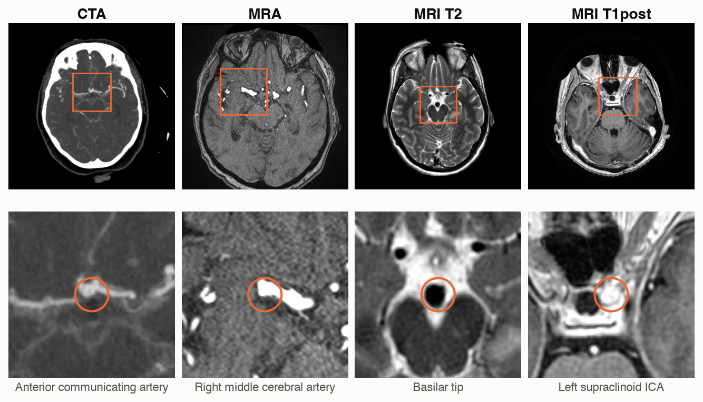
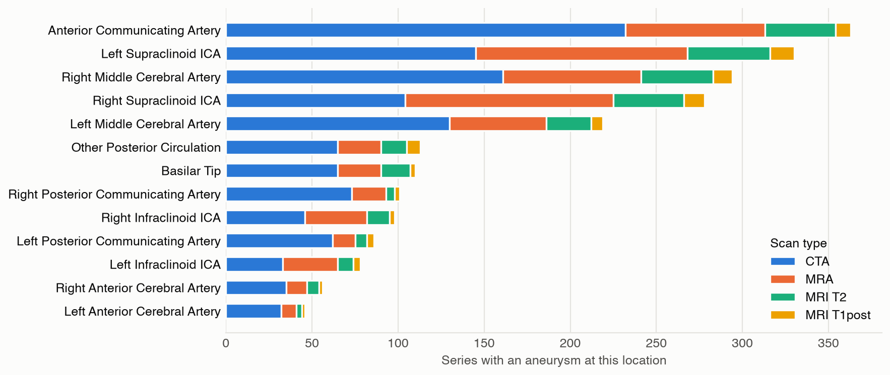
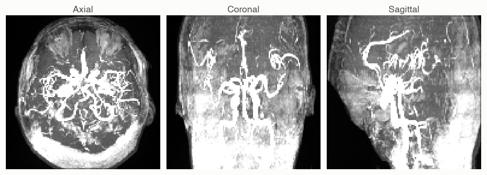

# Dataset

Neuro-Vision is trained and scored on the **RSNA Intracranial Aneurysm Detection** dataset
([Kaggle, 2025](https://www.kaggle.com/competitions/rsna-intracranial-aneurysm-detection);
[Correia de Verdier et al., 2026](https://arxiv.org/abs/2610.01135)). It holds expert-labelled 3D
brain scans from 18 sites. Each scan (one DICOM *series*) carries 14 binary labels: is an aneurysm
present, and on which of 13 arteries.

## At a glance

| | |
|:--|:--|
| Training set | 4,348 series; 311 GB of DICOM |
| Test set | About 2,500 hidden series, scored by Kaggle |
| Positive series | 1,863 (42.8%) |
| Patients | Age 18–89 (median 60); 3,005 female, 1,343 male |
| Extra annotations | 2,254 aneurysm centre points (all positive series); artery masks for 178 series |
| Missing values | None |

## Scan types

| Scan type | Series | Positive | Median slices | Median slice spacing |
|:--|--:|--:|--:|--:|
| CTA (CT angiography) | 1,808 | 53.8% | 337 | 0.63 mm |
| MRA (MR angiography) | 1,252 | 44.3% | 164 | 0.55 mm |
| MRI T2 | 983 | 26.2% | 30 | 5.0 mm |
| MRI T1 post-contrast | 305 | 25.2% | 166 | 1.0 mm |

Scan type shifts both image and base rate: CTA is positive twice as often as MRI, and T2 slices sit
eight times farther apart than CTA slices.

*Figure 1. One labelled aneurysm per scan type. Top: annotated slice. Bottom: 50 mm crop around the
expert's centre point. Flowing blood is bright on CTA, MRA and T1 post-contrast, and
dark on T2.*

## Classes

The task is multi-label: Aneurysm Present is 1 when any location is 1. Of the 1,863 positive
series, 249 have two to five locations.

| Label | CTA | MRA | T2 | T1post | Total | Share |
|:--|--:|--:|--:|--:|--:|--:|
| Left Infraclinoid Internal Carotid Artery | 33 | 32 | 9 | 4 | 78 | 1.8% |
| Right Infraclinoid Internal Carotid Artery | 46 | 36 | 13 | 3 | 98 | 2.3% |
| Left Supraclinoid Internal Carotid Artery | 145 | 123 | 48 | 14 | 330 | 7.6% |
| Right Supraclinoid Internal Carotid Artery | 104 | 121 | 41 | 12 | 278 | 6.4% |
| Left Middle Cerebral Artery | 130 | 56 | 26 | 7 | 219 | 5.0% |
| Right Middle Cerebral Artery | 161 | 80 | 42 | 11 | 294 | 6.8% |
| Anterior Communicating Artery | 232 | 81 | 41 | 9 | 363 | 8.3% |
| Left Anterior Cerebral Artery | 32 | 9 | 3 | 2 | 46 | 1.1% |
| Right Anterior Cerebral Artery | 35 | 12 | 7 | 2 | 56 | 1.3% |
| Left Posterior Communicating Artery | 62 | 13 | 7 | 4 | 86 | 2.0% |
| Right Posterior Communicating Artery | 73 | 20 | 5 | 3 | 101 | 2.3% |
| Basilar Tip | 65 | 25 | 17 | 3 | 110 | 2.5% |
| Other Posterior Circulation | 65 | 25 | 15 | 8 | 113 | 2.6% |
| **Aneurysm Present** | 973 | 555 | 258 | 77 | 1,863 | 42.8% |

The score is ½ · (AUC of Aneurysm Present + mean AUC of the 13 locations), so a rare artery counts
as much as a common one. The two anterior cerebral arteries have only 6–16 positives per validation
fold, so their AUCs are noisy.

*Figure 2. Positive series per location, coloured by scan type (ICA: internal carotid artery).*

## Model input

Each series is resampled to 128³ voxels in RAS orientation, clipped at its 0.5th and 99.5th
percentiles and z-scored. 4,311 series pass. The other 37 fail a geometry check, mostly mixed
orientation or slice gaps; they are left out of training and receive the label prior at prediction.

*Figure 3. The MRA series from Figure 1 after preprocessing (maximum-intensity projections). The 13
location labels name segments of this arterial tree.*

## Labels and splits

- **Corrected labels.** Training uses labels derived from the 26-class artery masks of Shi et al.
  (CC BY-NC 4.0). They change 7 cells in 4 series (2 left–right swaps), never Aneurysm Present
  (`data/manifests/labels.yaml`).
- **Folds.** Five folds, stratified by Aneurysm Present × scan type and grouped by
  FrameOfReferenceUID, so series from one scanning session share a fold
  ([check-point §2](check-point.md#2-splits-and-leakage); `data/manifests/folds.yaml`).

## Sources and access

Label counts: original `train.csv` (`results/audit.json`). Slices and spacing: the 4,311
preprocessed series. Competition rules restrict redistribution, so no scans, labels or fold
assignments are stored here; figures show training series without identifiers.
